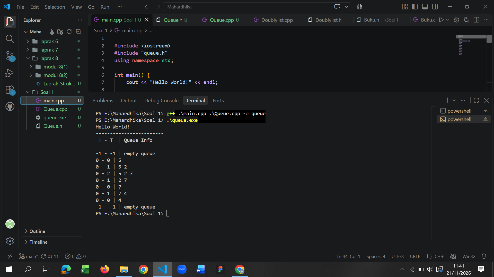

# <h1 align="center">Laporan Praktikum Modul 8 QUEUE</h1>
<p align="center">Mahardhika Putra Azlian - 109082500025</p>

## Dasar Teori 
Queue merupakan salah satu struktur data linear yang menggunakan prinsip FIFO (First In, First Out), yaitu data yang pertama kali masuk akan menjadi data pertama yang keluar. Queue memiliki dua posisi utama, yaitu head sebagai penunjuk elemen paling depan dan tail sebagai penunjuk elemen paling belakang. Dalam ADT (Abstract Data Type), Queue memiliki beberapa operasi dasar, seperti enQueue untuk menambahkan data, deQueue untuk menghapus data, isEmpty untuk memeriksa apakah Queue kosong, isFull untuk memeriksa apakah Queue penuh, dan viewQueue untuk menampilkan isi Queue. Implementasi Queue dapat dilakukan menggunakan Array maupun Linked List. Pada Array terdapat tiga alternatif mekanisme, yaitu Alternatif 1 dengan head diam dan tail bergerak serta melakukan pergeseran elemen saat penghapusan, Alternatif 2 dengan head dan tail bergerak tanpa pergeseran elemen, dan Alternatif 3 menggunakan sistem melingkar (Circular Queue) sehingga ruang kosong pada Array dapat digunakan kembali. Sementara itu, implementasi menggunakan Linked List memanfaatkan node yang saling terhubung melalui pointer next, dengan head menunjuk elemen pertama dan tail menunjuk elemen terakhir. Queue banyak digunakan dalam kehidupan sehari-hari, seperti antrean kasir, antrean kendaraan, dan sistem pencetakan dokumen. Dengan mempelajari ADT Queue, kita dapat memahami prinsip FIFO, cara kerja head dan tail, serta proses penambahan dan penghapusan data menggunakan Array maupun Linked List dalam bahasa pemrograman C++.
## Guided 
 
### Modul 8(1)
### 1. queue.h

```C++
#ifndef QUEUE_H_INCLUDE 
#define QUEUE_H_INCLUDE

#include <iostream>
using namespace std;

#define Nil NULL  

typedef bool boolean;
typedef int infotype;
typedef struct elmQ *address;  

struct elmQ{  
    infotype info;  
    address next; 
}; 

struct queue {  
    address head, tail; 
}; 

boolean isEmpty(queue Q); 
void CreateQueue(queue &Q); 
address alokasi(infotype X); 
void dealokasi(address P); 
address findElm(queue Q, infotype X); 
boolean fFindElm(queue Q, address P); 
void insert(queue &Q, address P); 
void deletequeue(queue &Q, address &P); 
void printInfo(queue Q); 
int nbList(queue Q); 
void delAll(queue &Q); 

#endif 
```

### 2. queue.cpp

```C++
#include "queue.h"

boolean isEmpty(queue Q) {
    return (Q.head == Nil);
}

void CreateQueue(queue &Q) {
    Q.head = Nil;
    Q.tail = Nil;
}

address alokasi(infotype X) {
    address P = new (nothrow) elmQ;
    if (P != Nil) {
        P->info = X;
        P->next = Nil;
    }
    return P;
}

void dealokasi(address P) {
    delete P;
}

address findElm(queue Q, infotype X) {
    address P = Q.head;
    while (P != Nil) {
        if (P->info == X) {
            return P;
        }
        P = P->next;
    }
    return Nil;
}

boolean fFindElm(queue Q, address P) {
    address R = Q.head;
    while (R != Nil) {
        if (R == P) {
            return true;
        }
        R = R->next;
    }
    return false;
}

void insert(queue &Q, address P) {
    if (isEmpty(Q)) {
        Q.head = P;
        Q.tail = P;
    } else {
        (Q.tail)->next = P;
        Q.tail = P;
    }
}

void deleteQueue(queue &Q, address &P) {
    P = Q.head;
    if (Q.head == Q.tail) {
        Q.head = Nil;
        Q.tail = Nil;
    } else {
        Q.head = P->next;
    }
    P->next = Nil;
}

void printInfo(queue Q) {
    if (isEmpty(Q)) {
        cout << "Queue kosong" << endl;
    } else {
        address P = Q.head;
        while (P != Nil) {
            cout << P->info << " ";
            P = P->next;
        }
        cout << endl;
    }
}

int nbList(queue Q) {
    int jumlah = 0;
    address P = Q.head;
    while (P != Nil) {
        jumlah++;
        P = P->next;
    }
    return jumlah;
}

void delAll(queue &Q) {
    address P;
    while (!isEmpty(Q)) {
        deleteQueue(Q, P);
        dealokasi(P);
    }
}
```

### 3. main.cpp

```C++
#include <iostream>
#include "queue.h"
using namespace std;

int main() {
    queue Q;
    address P;

    CreateQueue(Q);
    cout << "isEmpty : " << isEmpty(Q) << endl;
    printInfo(Q);

    insert(Q, alokasi(5));
    insert(Q, alokasi(2));
    insert(Q, alokasi(7));
    cout << "Setelah insert 5, 2, 7 " << endl;
    printInfo(Q);
    cout << "nbList : " << nbList(Q) << endl; 

    P = findElm(Q, 2);
    if (P != Nil) {
        cout << "findElm(2) ketemu, info = " << P->info << endl;
        cout << "fFindElm :" << fFindElm(Q, P) << endl;
    }
    if (findElm(Q, 9) == Nil) {
        cout << "findElm(9) tidak ketemu" << endl;
    }

    deletequeue(Q, P);
    cout << "Setelah delete, elemen yang keluar = " << P->info << endl;
    dealokasi(P);
    printInfo(Q);

    delAll(Q);
    cout << "Setelah delAll" << endl;
    printInfo(Q);
    cout << "isEmpty : " << isEmpty(Q) << endl;

    return 0;
}
```
penjelasan Implementasi ADT Queue pada Modul 8(1) menggunakan struktur data Linked List dengan prinsip FIFO (First In, First Out). Setiap elemen disimpan dalam node yang saling terhubung melalui pointer next, sedangkan head dan tail digunakan untuk menunjukkan elemen pertama dan terakhir. Melalui fungsi insert, deleteQueue, findElm, nbList, dan delAll, kita dapat menambahkan, menghapus, mencari, menghitung, serta menghapus seluruh data dalam Queue. Penggunaan Linked List memungkinkan jumlah elemen bertambah sesuai kebutuhan selama memori tersedia, tanpa harus menentukan kapasitas array sejak awal.

### Modul 8(2)

### queue.h

```C++
#ifndef QUEUE_H
#define QUEUE_H

#include <iostream>
using namespace std;

const int MAKSIMAL = 5;

struct queue {
    string nama[MAKSIMAL];
    int head;
    int tail;
};

bool isFull(queue Q);
bool isEmpty(queue Q);
void CreateQueue(queue &Q);
void enQueue(queue &Q, string nama);
void deQueue(queue &Q);
void viewQueue(queue Q);

#endif
```

### queue.cpp
```C++
#include "queue.h"
#include <iostream>

using namespace std;

// NOTE : 
// Implementasi 1 = head diam, tail bergerak (Queue Linear Statis, kerana head nya tetap diam)
// Implementasi 2 = head bergerak, tail bergerak (Queue Linear Dinamis, karena head & tail nya sama-sama bergerak)
// Implementasi 3 = head dan tail berputar (Queue Circular, karena jika udh mentok tapi masih ada space, diputar sehingga tail bisa ada didepan head)

bool isEmpty(queue Q){
    if(Q.head == -1 && Q.tail == -1){
        return true;
    } else {
        return false;
    }
}

//isFull implmenetasi 1 & 2
bool isFull(queue Q){
    if(Q.tail == MAKSIMAL - 1){
        return true;
    } else {
        return false;
    }
}

// //isFull implementasi 3
// bool isFull(queue Q){
//     if((Q.tail + 1) % MAKSIMAL == Q.head){
//         return true;
//     } else {
//         return false;
//     }
// }

void CreateQueue(queue &Q){ //terbentuk queue dengan head = -1 dan tail = -1 
    Q.head = -1;
    Q.tail = -1;
}
 

//enqueue implementasi 1 & 2
void enQueue(queue &Q, string nama){
    if(isFull(Q) == true){
        cout << "Queue sudah penuh!" << endl;
    } else {
        if(isEmpty(Q) == true){
            Q.head = Q.tail = 0;
        } else {
            Q.tail++;
        }
        Q.nama[Q.tail] = nama;
        cout << "nama " << nama << " berhasil ditambahkan kedalam queue!" << endl;
    }
}

// //enQueue implementasi 3
// void enQueue(queue &Q, string nama){
//     if(isFull(Q) == true){
//         cout << "Queue sudah penuh!" << endl;
//     } else {
//         if(isEmpty(Q) == true){
//             Q.head = Q.tail = 0;
//         } else {
//             Q.tail = (Q.tail + 1) % MAKSIMAL; // bergerak melingkar
//         }
//         Q.nama[Q.tail] = nama;
//         cout << "nama " << nama << " berhasil ditambahkan kedalam queue!" << endl;
//     }
// }

//dequeue implementasi 1
void deQueue(queue &Q){
    if(isEmpty(Q) == true){
        cout << "Queue kosong!" << endl;
    } else {
        cout << "Mengahapus data " << Q.nama[Q.head] << "..." << endl;
        for(int i = 0; i < Q.tail; i++){
            Q.nama[i] =  Q.nama[i+1];
        }
        Q.tail--;
        if(Q.tail < 0){ //kalo semua isi queue nya udh dikelaurin, set head & tail ke -1
            Q.head = -1;
            Q.tail = -1;
        }
    }
}

// //dequeue implementasi 2
// void deQueue(queue &Q){
//     if(isEmpty(Q) == true){
//         cout << "Queue kosong!" << endl;
//     } else {
//         cout << "Mengahapus data " << Q.nama[Q.head] << "..." << endl;
//         Q.head++;
//         if(Q.head > Q.tail){ //kalo elemennya udh abis (head akan lebih 1 dari tail), maka reset ulang head & tail ke -1
//             Q.head = -1;
//             Q.tail = -1;
//         }
//     }
// }

// //deQueue implementasi 3
// void deQueue(queue &Q){
//     if(isEmpty(Q) == true){
//         cout << "Queue kosong!" << endl;
//     } else {
//         cout << "Mengahapus data " << Q.nama[Q.head] << "..." << endl;
//         if(Q.head == Q.tail){ //kalo elemennya tinggal 1, langsungkan saja head & tail nya reset ke -1
//             Q.head = -1;
//             Q.tail = -1;
//         } else {
//             Q.head = (Q.head + 1) % MAKSIMAL; // bergerak melingkar
//         }
//     }
// }

//viewQueue implementasi 1 & 2
void viewQueue(queue Q){
    if(isEmpty(Q) == true){
        cout << "Queue kosong!" << endl;
    } else {
        for(int i = Q.head; i <= Q.tail; i++){
            cout << i -  Q.head + 1 << ". " << Q.nama[i] << endl;
        }
    }
    cout << endl;
}

// //viewQueue implementasi 3
// void viewQueue(queue Q){
//     if(isEmpty(Q) == true){
//         cout << "Queue kosong!" << endl;
//     } else {
//         int i = Q.head;
//         int count = 1;
//         while(true){
//             cout << count << ". " << Q.nama[i] << endl;
//             if(i == Q.tail){
//                 break;
//             }
//             i = (i + 1) % MAKSIMAL;
//             count++;
//         }   
//     }
// }
```

### main.cpp
```C++
#include "queue.h"
#include <iostream>

using namespace std;

int main(){
    queue Q;

    CreateQueue(Q);
    enQueue(Q, "Dimas");
    enQueue(Q, "Arvin");
    enQueue(Q, "Rizal");
    enQueue(Q, "Hafizh");
    enQueue(Q, "Fathur");
    enQueue(Q, "Daffa");
    cout << endl;

    cout << "--- Isi Queue Setelah enQueue ---" << endl;
    viewQueue(Q);
    cout << endl;

    deQueue(Q);
    deQueue(Q);
    deQueue(Q);
    deQueue(Q);
    // deQueue(Q);
    // deQueue(Q);
    cout << endl;

    cout << "--- Isi Queue Setelah deQueue ---" << endl;
    viewQueue(Q);

    return 0;
}
```
penjelasan Berdasarkan implementasi ADT Queue menggunakan ARRAY dengan data bertipe string, dapat disimpulkan bahwa Queue bekerja menggunakan prinsip FIFO (First In, First Out), yaitu data yang pertama dimasukkan akan menjadi data pertama yang dikeluarkan. Program ini menggunakan fungsi enQueue untuk menambahkan nama ke dalam Queue, deQueue untuk menghapus data paling depan, isFull dan isEmpty untuk memeriksa kondisi Queue, serta viewQueue untuk menampilkan isi Queue. Dengan kapasitas maksimal 5 elemen, program juga menunjukkan bahwa data tidak dapat ditambahkan ketika Queue sudah penuh. Melalui implementasi ini, dapat dipahami bagaimana pengelolaan data Queue dilakukan menggunakan posisi head dan tail serta bagaimana proses penambahan dan penghapusan data berlangsung.

### Unguided 

### 1. soal 1

### queue.h

```C++

#ifndef QUEUE_H
#define QUEUE_H

typedef int infotype;

struct Queue {
    infotype info[5];
    int head, tail;
};

void createQueue(Queue &Q);
bool isEmptyQueue(Queue Q);
bool isFullQueue(Queue Q);
void enqueue(Queue &Q, infotype x);
infotype dequeue(Queue &Q);
void printInfo(Queue Q);

#endif
```

### queue.cpp
```C++

#include <iostream>
#include "Queue.h"
using namespace std;

void createQueue(Queue &Q) {
    Q.head = -1;
    Q.tail = -1;
}

bool isEmptyQueue(Queue Q) {
    return Q.head == -1 && Q.tail == -1;
}

bool isFullQueue(Queue Q) {
    return Q.tail == 4;
}

void enqueue(Queue &Q, infotype x) {
    if (!isFullQueue(Q)) {
        if (isEmptyQueue(Q)) {
            Q.head = 0;
            Q.tail = 0;
        } else {
            Q.tail++;
        }

        Q.info[Q.tail] = x;
    }
}

infotype dequeue(Queue &Q) {
    infotype x;

    if (!isEmptyQueue(Q)) {
        x = Q.info[Q.head];

        if (Q.head == Q.tail) {
            Q.head = -1;
            Q.tail = -1;
        } else {
            for (int i = 0; i < Q.tail; i++) {
                Q.info[i] = Q.info[i + 1];
            }
            Q.tail--;
        }

        return x;
    }

    return -1;
}

void printInfo(Queue Q) {
    if (isEmptyQueue(Q)) {
        cout << "-1 - -1 | empty queue" << endl;
    } else {
        cout << Q.head << " - " << Q.tail << " | ";

        for (int i = Q.head; i <= Q.tail; i++) {
            cout << Q.info[i] << " ";
        }

        cout << endl;
    }
}
```

### main.cpp
```C++

#include <iostream>
#include "queue.h"
using namespace std;

int main() {
    cout << "Hello World!" << endl;

    Queue Q;
    createQueue(Q);

    cout << "------------------------" << endl;
    cout << " H - T  | Queue Info" << endl;
    cout << "------------------------" << endl;

    printInfo(Q);

    enqueue(Q, 5);
    printInfo(Q);

    enqueue(Q, 2);
    printInfo(Q);

    enqueue(Q, 7);
    printInfo(Q);

    dequeue(Q);
    printInfo(Q);

    dequeue(Q);
    printInfo(Q);

    enqueue(Q, 4);
    printInfo(Q);

    dequeue(Q);
    printInfo(Q);

    dequeue(Q);
    printInfo(Q);

    return 0;
}
```
### Output Unguided 1 :

##### Output 1



penjelasan unguided 1 Pada alternatif ini, posisi head tetap berada di indeks 0 selama Queue tidak kosong, sedangkan tail bergerak mengikuti jumlah elemen. Ketika dilakukan operasi dequeue, elemen yang tersisa akan digeser ke depan agar posisi head tetap berada di indeks 0.

### 2. soal 2

### queue.h

```C++

#ifndef QUEUE_H
#define QUEUE_H

typedef int infotype;

struct Queue {
    infotype info[5];
    int head, tail;
};

void createQueue(Queue &Q);
bool isEmptyQueue(Queue Q);
bool isFullQueue(Queue Q);
void enqueue(Queue &Q, infotype x);
infotype dequeue(Queue &Q);
void printInfo(Queue Q);

#endif
```

### queue.cpp
```C++

#include <iostream>
#include "Queue.h"
using namespace std;

void createQueue(Queue &Q) {
    Q.head = -1;
    Q.tail = -1;
}

bool isEmptyQueue(Queue Q) {
    return Q.head == -1 && Q.tail == -1;
}

bool isFullQueue(Queue Q) {
    return Q.tail == 4;
}

void enqueue(Queue &Q, infotype x) {
    if (!isFullQueue(Q)) {
        if (isEmptyQueue(Q)) {
            Q.head = 0;
            Q.tail = 0;
        } else {
            Q.tail++;
        }

        Q.info[Q.tail] = x;
    }
}

infotype dequeue(Queue &Q) {
    if (isEmptyQueue(Q)) {
        return -1;
    }

    infotype x = Q.info[Q.head];

    if (Q.head == Q.tail) {
        Q.head = -1;
        Q.tail = -1;
    } else {
        for (int i = 0; i < Q.tail; i++) {
            Q.info[i] = Q.info[i + 1];
        }
        Q.tail--;
    }

    return x;
}

void printInfo(Queue Q) {
    if (isEmptyQueue(Q)) {
        cout << "-1 - -1 | empty queue" << endl;
    } else {
        cout << Q.head << " - " << Q.tail << " | ";

        for (int i = Q.head; i <= Q.tail; i++) {
            cout << Q.info[i] << " ";
        }

        cout << endl;
    }
}
```

### main.cpp
```C++

#include <iostream>
#include "queue.h"
using namespace std;

int main() {
    cout << "Hello World!" << endl;

    Queue Q;
    createQueue(Q);

    cout << "------------------------" << endl;
    cout << " H - T  \t | Queue Info" << endl;
    cout << "------------------------" << endl;

    printInfo(Q);

    enqueue(Q, 5);
    printInfo(Q);

    enqueue(Q, 2);
    printInfo(Q);

    enqueue(Q, 7);
    printInfo(Q);

    dequeue(Q);
    printInfo(Q);

    dequeue(Q);
    printInfo(Q);

    enqueue(Q, 4);
    printInfo(Q);

    dequeue(Q);
    printInfo(Q);

    dequeue(Q);
    printInfo(Q);

    return 0;
}
```
### Output Unguided 2 :

##### Output 1


penjelasan unguided 2 Pada alternatif ini, posisi head dan tail sama-sama bergerak sesuai operasi yang dilakukan. Ketika dequeue, posisi head bertambah satu tanpa menggeser elemen. Namun, ruang kosong di bagian depan array tidak dapat digunakan kembali sebelum Queue menjadi kosong.
### 3. soal 3

### queue.h

```C++

#ifndef QUEUE_H
#define QUEUE_H

typedef int infotype;

struct Queue {
    infotype info[5];
    int head, tail;
};

void createQueue(Queue &Q);
bool isEmptyQueue(Queue Q);
bool isFullQueue(Queue Q);
void enqueue(Queue &Q, infotype x);
infotype dequeue(Queue &Q);
void printInfo(Queue Q);

#endif
```

### queue.cpp
```C++
#include <iostream>
#include "Queue.h"
using namespace std;

void createQueue(Queue &Q) {
    Q.head = -1;
    Q.tail = -1;
}

bool isEmptyQueue(Queue Q) {
    return Q.head == -1 && Q.tail == -1;
}

bool isFullQueue(Queue Q) {
    return (Q.tail + 1) % 5 == Q.head;
}

void enqueue(Queue &Q, infotype x) {
    if (!isFullQueue(Q)) {
        if (isEmptyQueue(Q)) {
            Q.head = 0;
            Q.tail = 0;
        } else {
            Q.tail = (Q.tail + 1) % 5;
        }

        Q.info[Q.tail] = x;
    }
}

infotype dequeue(Queue &Q) {
    if (isEmptyQueue(Q)) {
        return -1;
    }

    infotype x = Q.info[Q.head];

    if (Q.head == Q.tail) {
        Q.head = -1;
        Q.tail = -1;
    } else {
        Q.head = (Q.head + 1) % 5;
    }

    return x;
}

void printInfo(Queue Q) {
    if (isEmptyQueue(Q)) {
        cout << "-1 - -1 | empty queue" << endl;
    } else {
        cout << Q.head << " - " << Q.tail << " | ";

        int i = Q.head;

        while (true) {
            cout << Q.info[i] << " ";

            if (i == Q.tail) {
                break;
            }

            i = (i + 1) % 5;
        }

        cout << endl;
    }
}
```

### main.cpp
```C++

#include <iostream>
#include "queue.h"
using namespace std;

int main() {
    cout << "Hello World!" << endl;

    Queue Q;
    createQueue(Q);

    cout << "------------------------" << endl;
    cout << " H - T  \t | Queue Info" << endl;
    cout << "------------------------" << endl;

    printInfo(Q);

    enqueue(Q, 5);
    printInfo(Q);

    enqueue(Q, 2);
    printInfo(Q);

    enqueue(Q, 7);
    printInfo(Q);

    dequeue(Q);
    printInfo(Q);

    dequeue(Q);
    printInfo(Q);

    enqueue(Q, 4);
    printInfo(Q);

    dequeue(Q);
    printInfo(Q);

    dequeue(Q);
    printInfo(Q);

    return 0;
}
```

### Output Unguided 3 :

##### Output 1


penjelasan unguided 3 Pada alternatif ini, posisi head dan tail bergerak secara melingkar (Circular Queue). Ketika mencapai indeks terakhir array, posisi berikutnya akan kembali ke indeks 0. Dengan mekanisme ini, ruang kosong pada array dapat digunakan kembali sehingga penggunaan kapasitas array menjadi lebih efisien.

## Kesimpulan
praktikum implementasi ADT Queue menggunakan ARRAY dengan tiga alternatif, dapat disimpulkan bahwa Queue merupakan struktur data yang menggunakan prinsip FIFO (First In, First Out), yaitu data yang pertama masuk akan menjadi data pertama yang keluar. Dalam implementasinya, terdapat tiga mekanisme pengelolaan posisi head dan tail. Alternatif 1 menggunakan posisi head yang tetap dan melakukan pergeseran elemen ketika dequeue. Alternatif 2 menggunakan head dan tail yang bergerak tanpa melakukan pergeseran elemen, tetapi ruang kosong di depan tidak dapat digunakan kembali. Sementara itu, Alternatif 3 menggunakan sistem melingkar (Circular Queue), sehingga posisi head dan tail dapat berputar kembali ke indeks awal dan memanfaatkan ruang kosong pada array.

## Referensi
[1] 1. OpenDSA. (n.d.). Queues. Virginia Tech. OpenDSA – Queue.<br>
[2] cppreference.com. (n.d.). std::queue. C++ Reference – std::queue.<br>
[3] Goodrich, M. T., Tamassia, R., & Goldwasser, M. H. (2014). Data Structures and Algorithms in Java (6th ed.). Wiley.<br>
[4] Klukowska, J. (n.d.). Abstract Data Types: Lists, Stacks and Queues. New York University. Materi Kuliah NYU.<br>
